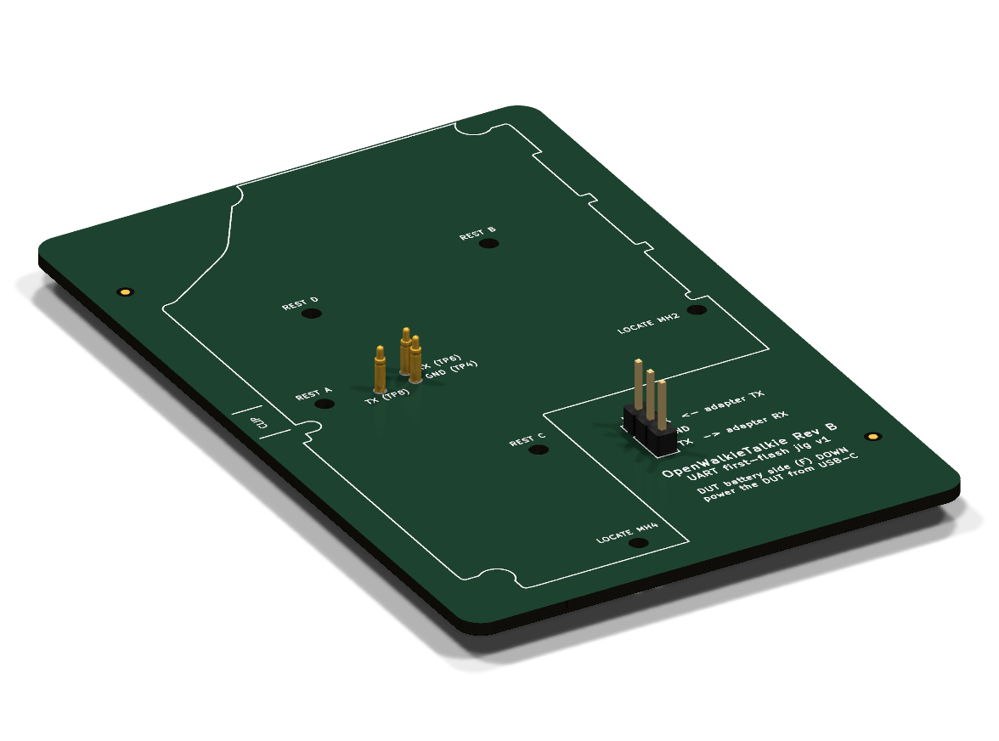
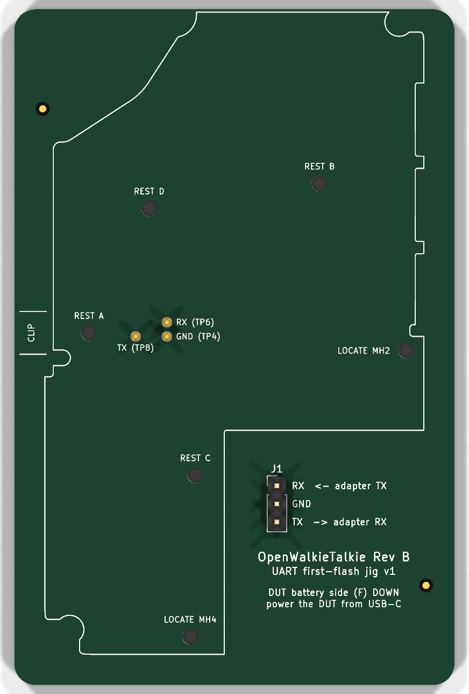
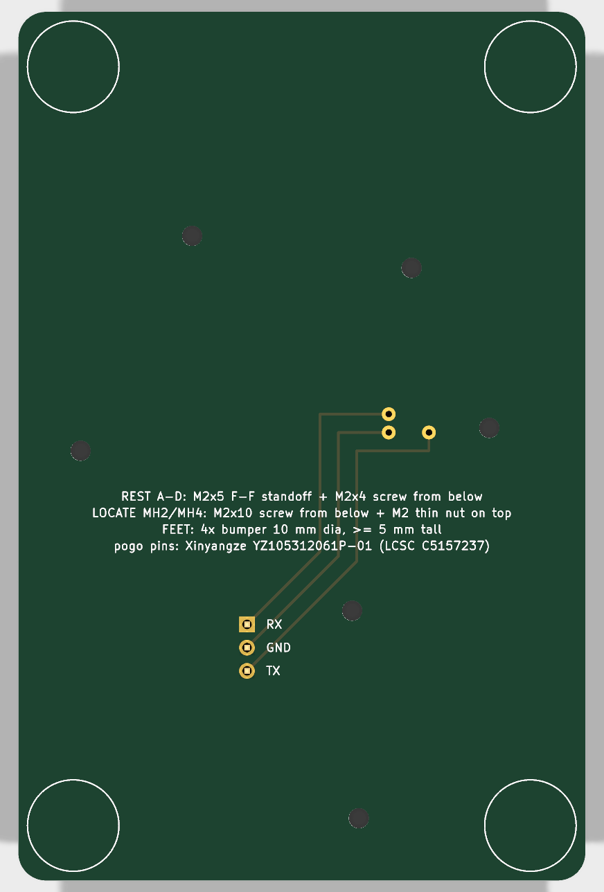

# Rev B UART first-flash jig

This plate flashes a blank Rev B main board over its UART debug pads with no
soldering. The SF32's boot ROM only listens on UART1, so every new board needs
this once, for the flash table and the recovery bootloader. After that, every
update goes over USB-C (`tools/flash-usb.py`). The plate is also the way back
when a bootloader write was interrupted, and it gives you the UART debug log.

| Top (the DUT side) | Bottom |
|---|---|
|  |  |

## How it works

- The DUT lies **battery side (F) down** on the plate. The silkscreen shows its
  outline, which is mirrored because you see the board from its back.
- Three pogo pins touch the debug pads:
  - **TP6** (DUT RX)
  - **TP4** (GND)
  - **TP8** (DUT TX)

  TP3 (CAL), TP5 (reset) and TP10 (3V3) get no pin. Nothing can hold the board
  in reset or feed it through its 3.3 V rail.
- **Locators:** two M2 screws come up through the DUT's own mounting holes
  **MH2 and MH4**, so the board only fits one way.
- **Rests:** four M2×5 standoffs (REST A–D) hold the DUT's F face 5.0 mm above
  the plate.
  - The tallest F-side parts are 3.4 mm (J1/J3 PicoBlade, the USB-C shell), so
    they clear by 1.6 mm.
  - Every rest stands on bare soldermask, at least 3 mm from any F-side part or
    pad and from the board edge.
- **Hold-down:** press on the DUT's back over the pins (no parts there on the B
  side), or put a small binder clip at **CLIP**. That spot is on the DUT edge,
  over REST A.
- **Power:** plug a USB-C cable into the DUT. The plate stops at y = 3 mm, so
  the plug's overmold clears it.
- **J1** is the adapter header:

  | J1 pin | Signal | Wire to the adapter's |
  |---|---|---|
  | 1 | DUT RX | TX |
  | 2 | GND | GND |
  | 3 | DUT TX | RX |

  Any 3.3 V USB-UART adapter works; the DAPLink's CDC UART is the one used so
  far.

Every DUT position (pads, holes, outline) is read from
`../main/main-revb.kicad_pcb` by `scripts/gen_jig.py`. If the main board
moves, regenerate the plate.

## The pogo pin

**Xinyangze YZ105312061P-01, LCSC/JLCPCB C5157237** (extended part, 423 in
stock and about $0.38 on 2026-10-09).

| | |
|---|---|
| Body | 1.24 mm diameter, 0.8 mm plunger, domed tip, gold over brass |
| Length | 6.1 mm overall; operational height 4.2 mm |
| Force | 120 gf rated |
| Life | 10,000 cycles |
| Mount | Reflowed, tail in a 0.70 mm plated hole (self-centring) on a 1.5 mm ring |

Why this part:
- **Width.** TP6 and TP4 are only 2.0 mm apart. Every other pogo pin JLCPCB
  stocks is 2 mm wide (`D=2mm`), and Mill-Max's 0906 (1.07 mm plunger) is out
  of stock at JLCPCB and LCSC.
- **Force.** The 1.2–1.3 mm pins that are in stock (YZ87312060R-01,
  YZP0265-12060-01) are rated 20 gf. That is light for a jig that is pressed by
  hand.

**Check one pin with calipers when it arrives.** The datasheet has no drawing:
- The dimensions above come from the LCSC/EasyEDA 3D model and the listing.
- That model puts the free height at about **5.5 mm above the plate**, so at
  the 5.0 mm rest height the pin compresses about 0.5 mm.
- If contact is weak, use **M2×4.5** standoffs. That gives about 1.0 mm of
  compression and still stops short of the pin's ~1.5 mm stroke.
- Do not shim the standoffs up: higher rests mean less compression.

## Bill of materials

Assembled by JLCPCB (`fab-jlcpcb/`):

| Ref | Part | LCSC | Qty |
|---|---|---|---|
| P1–P3 | Pogo pin, Xinyangze YZ105312061P-01 | C5157237 | 3 |
| J1 | 1×3 2.54 mm pin header, BOOMELE | C49257 | 1 |

Hardware you add:

| Qty | Part | Where |
|---|---|---|
| 4 | M2×5 hex standoff, female–female | REST A–D |
| 4 | M2×4 screw | from below, into the rests |
| 2 | M2×10 screw | LOCATE MH2/MH4, from below |
| 2 | M2 **thin** nut (DIN 439, 1.2 mm) | on top, locks each locator screw |
| 4 | Self-adhesive bumper, about 10 mm diameter, ≥ 5 mm tall | FEET circles on the bottom |

Use the thin nut at MH4: the speaker connector J1 on the DUT hangs to 1.6 mm
above the plate beside it. A standard 1.6 mm nut would touch it. Each
locator screw ends 8.4 mm above the plate, which is 2.4 mm above the DUT's
back.

## Ordering

The JLCPCB package is in `fab-jlcpcb/`:
- `revb-flash-jig-gerber.zip`
- `revb-flash-jig-bom-jlcpcb.csv`
- `revb-flash-jig-cpl-jlcpcb.csv`

Board settings: 2 layers, 62 × 95 mm, 1.6 mm FR4. Any finish works; this is
a tool, not the DUT.

PCBA: top side only.
- The pogo pins are SMT-placed into their plated holes.
- J1 is through-hole (or solder it yourself).
- Check JLCPCB's placement preview: the pins sit 2.0 mm apart.

Order spare pins. They are rated 10k cycles.

## Using it

1. Fit the rests and locators, and stick on the feet.
2. Wire J1 to the adapter: RX→TX, TX→RX, GND.
3. Lay the DUT on the plate battery side down, with the locator screws through
   MH2/MH4. Press it down at CLIP (or clip it), and plug in USB-C.
4. Flash as for Rev A (`tools/flash-uart.py`). The port answers at any time,
   so no power-cycle timing is needed. `--compat true` (the default) covers the
   DAPLink's CDC bridge.
5. From then on, use USB-C only (`tools/flash-usb.py`).

Rev B needs the firmware pin-map changes in
[`../README.md`](../README.md#firmware-changes-needed-before-bring-up) before
its application image is usable. The flash table and bootloader do not depend
on them.

## Files

| What | Where |
|---|---|
| Board (KiCad 10.0.4, generated) | `revb-flash-jig.kicad_pcb`, `.kicad_pro` (the Rev B rules) |
| Pogo footprint + 3D model | `revb-jig.pretty/`, `models/YZ105312061P-01.wrl` (converted from the LCSC/EasyEDA model) |
| Generator | `scripts/gen_jig.py`, run with KiCad's bundled python |
| Fab outputs, DRC, renders | `scripts/make_fab.sh` → `fab-jlcpcb/`, `verification/`, `render-*.png` |
| DRC (all severities) | [`verification/revb-flash-jig-drc.rpt`](verification/revb-flash-jig-drc.rpt): 0 violations, 0 unconnected |
